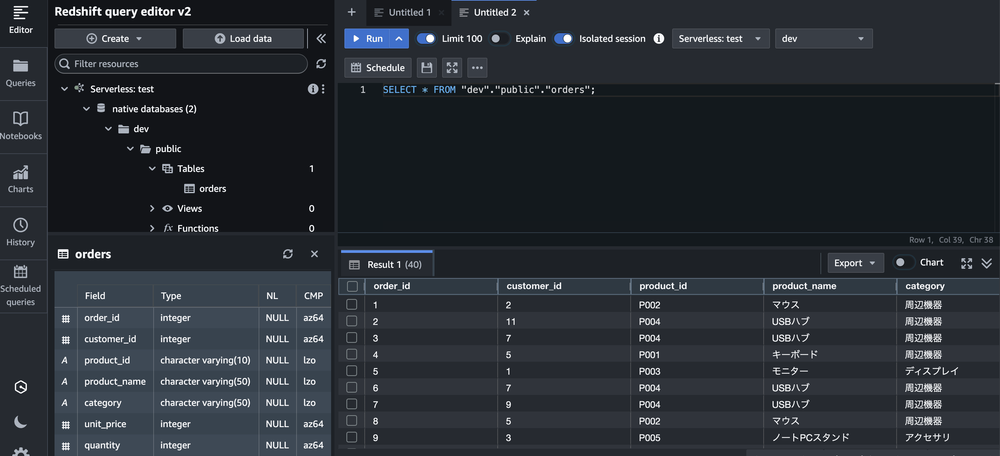

# AWS Redshift

- いわゆる列指向のDB。DWH
- Big Query に思ったよりも似ている
  - https://www.acceluniverse.com/blog/developers/2024/10/redshift-bigquery-usability.html
  - https://data.gunosy.io/entry/sql_with_redshift_and_bigquery
- Athena にも似ている
  - コンピューティングの使用量を気にする必要あるってのはAthenaとの大きな違いかも
  - https://business.ntt-east.co.jp/content/cloudsolution/column-116.html#section-2
- VPCリソースっぽい。subnetやsgを選択する必要ある
- Serverless あり
  - https://www.ctc-g.co.jp/solutions/cloud/column/article/46.html
- Serverless には namespace とワークグループがある
  - 1:1らしい
  - ワークグループというのはコンピューティングのこと。
  - VPC の設定とかはワークグループ持ち
  - namespace ってのは OpenSearch Serverless の Collection 的なものかも。
  - https://www.qes.co.jp/media/aws/a228
- 思ったより使いやすい
- クエリエディタ的なのもある
  - 

## Links
- https://www.ctc-g.co.jp/solutions/cloud/column/article/154.html
