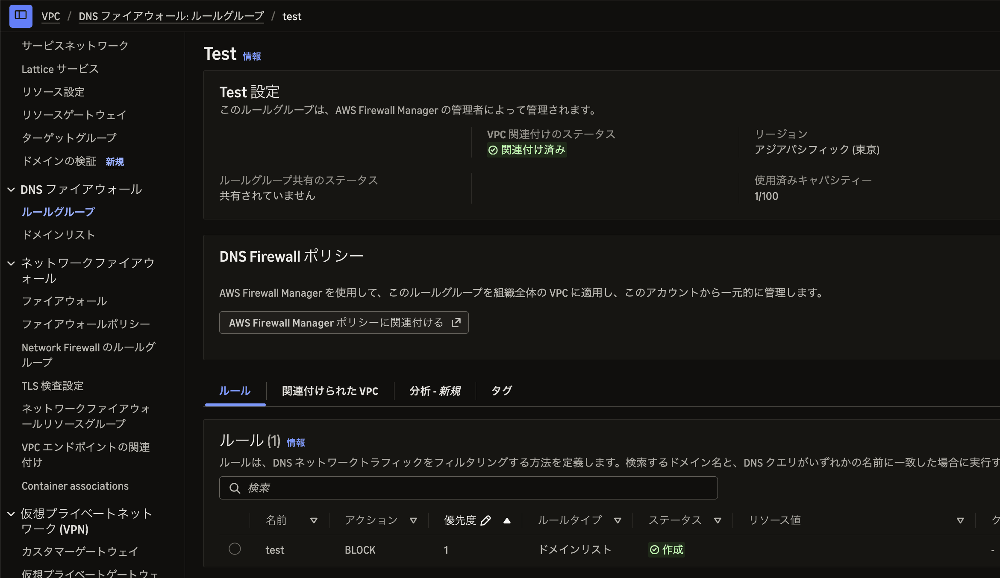
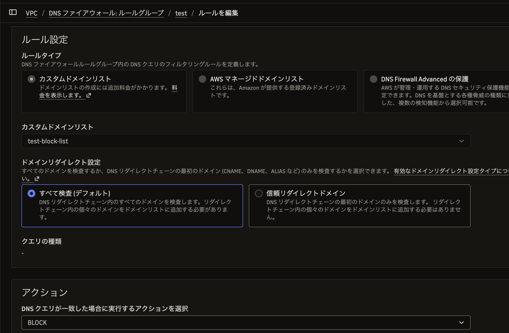

# Route53 Resolver DNS Firewall

- VPC DNS Firewall とも。
  - Route53 のコンソールでリソース作ったらいつのまにか VPC のコンソールにいた..
- VPC ないで名前解決するときに、それが怪しいドメインであればブロックする。
- ざっくり WAF と同じようなかんじ。
  - AWS のマネージドルールがあり怪しい宛先であればブロックする
  - あるいはカスタムのルールもある。特定ドメインをブロックしたり。
  - ブロックというのは、要は名前解決させないってこと。存在しないドメイン扱い
- クエリ数は CloudWatch Metrics で確認できる

### 設定例
例えば example.com をブロックする

- 
- 

すると

```bash
$ curl example.com -i
curl: (6) Could not resolve host: example.com

$ curl yahoo.co.jp -i
HTTP/1.1 301 Redirect
Location: https://www.yahoo.co.jp:443/
```

## Links
- https://blog.serverworks.co.jp/route-53-resolver-dns-firewall
