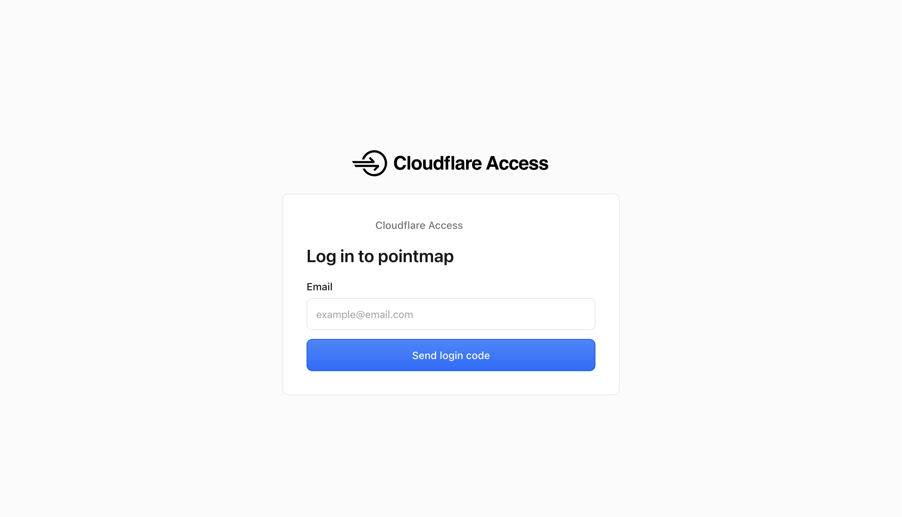
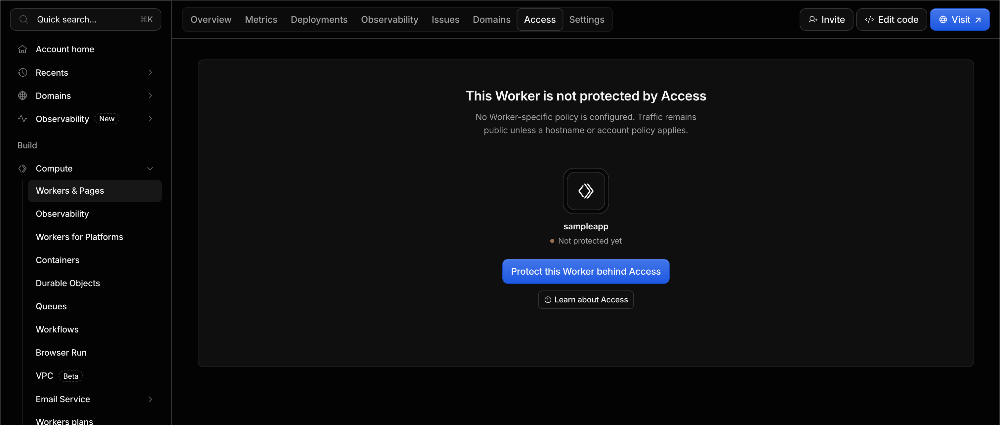
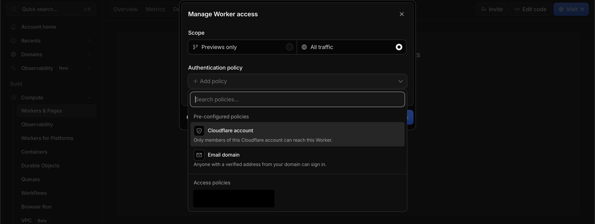
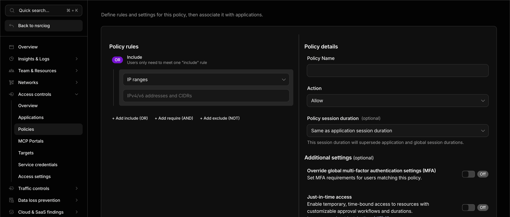

# Cloudflare Access

- ウェブサイトの前段に認証機構を置いてくれるやつ
- 事例はそれなりにある認識
- 実際使ってみると難しかった
  - 何が難しいかというと設定画面
  - どこを見ればいいか分からん。
  - 文字も多いし
  - 設定内容が多いのはまあ仕方ないと思う
- 基本的には cloudflare zero trust のコンソールで、
  - ポリシーを作成
  - アプリケーションを作成、ポリシーを貼る  
  でよい。ポリシーが多くなったらルールグループを作った方が便利だろうけど、最初はルールグループいらないと思う
- cloudflare でホストしているアプリだけでなくて外部のパブリック/プライベートアプリケーションの前段にもおけるっぽい
  - っぽいけど試してないのでどんなことが必要なのか不明
  - パブリックの前段においても直でアクセスされたらダメなわけだし
- 実際にかけるとこんな感じのログインページ  
  
- Cloudflare Zero Trust という製品群の中の1サービスという認識

## Workers に Access による制限をかける

- Workers のコンソールより Access の設定が可能
- IPアドレス制限だけをかけることが可能だと思っていたがそういうわけではなく、必ず Cloudflare のアカウントでログインする必要あるっぽい
- 
- 
- 
- https://developers.cloudflare.com/workers/configuration/cloudflare-access/
- ちなみに Workers 単体へIPアドレス制限をかけるのは無理そうに見えている。カスタムドメインをつければそっちの方のルールでIPアドレス制限は可能
  - https://developers.cloudflare.com/rules/

## Links
- https://blogs.networld.co.jp/entry/2026/03/31/100251
- https://zenn.dev/smartshopping/articles/fd2825c0c61149
