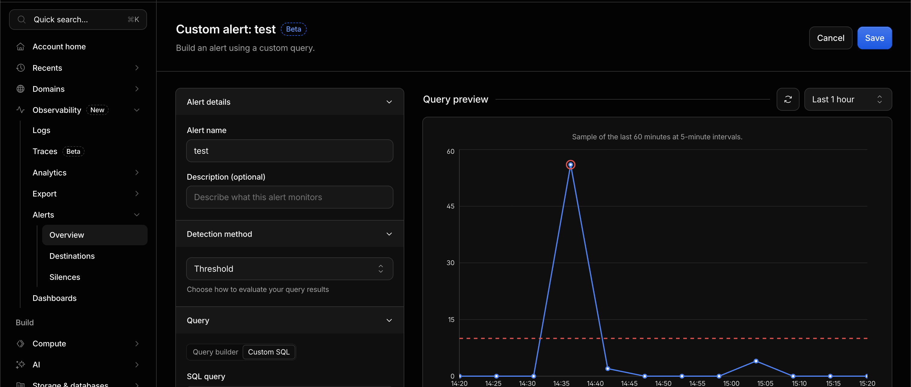

# Cloudflare Alert

- いわゆるアラート。監視用
- AWS でいう CloudWatch Alert にちかい。
- メトリクスを指定して、そのメトリクスの値が閾値を超えたらメール通知みたいなイメージ
- 例えばHTTPリクエスト5xxが増えた時に通知するには
  - Dataset: HTTP Requests
  - Metric: Count rows
  - Filter: originResponseStatus >= 500
  とすれば良さそう
- 

## Links
- https://developers.cloudflare.com/notifications/reference/traffic-alerts/
