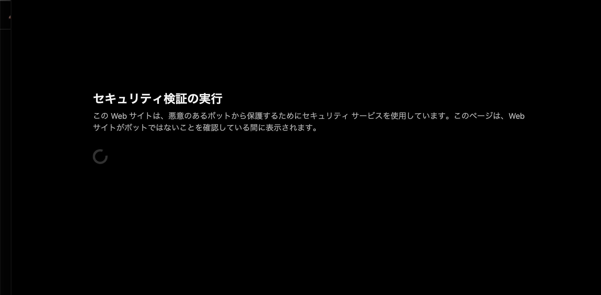

# Cloudflare Security Rules

- いわゆるWAF
- Cloudflare WAFとの違いはわかってない
  - なんかコンソールのトップページから Cloudflare WAF を有効化しようとすると問い合わせページにうつる
  - ドメインの詳細ページにいって、そこの Security > Security Rules は使えた。のでそれを試す。
- ざっくりAWS WAFに似ている
  - リクエストのパスやヘッダー等を条件に Block や Challenge アクションを実施できる
- Non Interactive Challenge アクション
  - これはたまにみるやつ。
  - Cloudflare の黒い画面が数秒表示されて、その後実際のページに遷移する。
  - この画面はカスタマイズできるらしい？
  - 
- Interactive Challenge アクション
  - 人間に操作を要求する
  - Challenge というか CAPTCHA に似ているかな
  - 
- Managed Challenge アクション
  - Non Interactive Challenge か Interactive Challenge のどちらかを表示するっぽい
  - https://blog.cloudflare.com/ja-jp/end-cloudflare-captcha
  - https://zenn.dev/kameoncloud/articles/5e7626ed64624c
