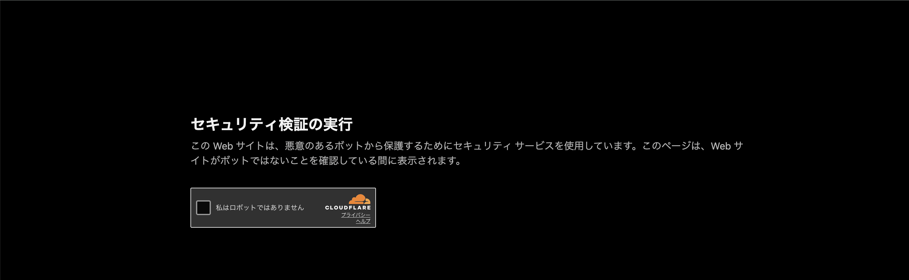

# Cloudflare Security Rules

- いわゆるWAF
- Cloudflare WAFとの違いはわかってない
  - なんかコンソールのトップページから Cloudflare WAF を有効化しようとすると問い合わせページにうつる
  - ドメインの詳細ページにいって、そこの Security > Security Rules は使えた。のでそれを試す。
- ざっくりAWS WAFに似ている
  - リクエストのパスやヘッダー等を条件に Block や Challenge アクションを実施できる
- Managed Challenge アクション
  - これはたまにみるやつ。
  - Challenge というか CAPTCHA に似ているかな。人間に操作を要求する点で。
  - 
  - https://blog.cloudflare.com/ja-jp/end-cloudflare-captcha
  - https://zenn.dev/kameoncloud/articles/5e7626ed64624c
