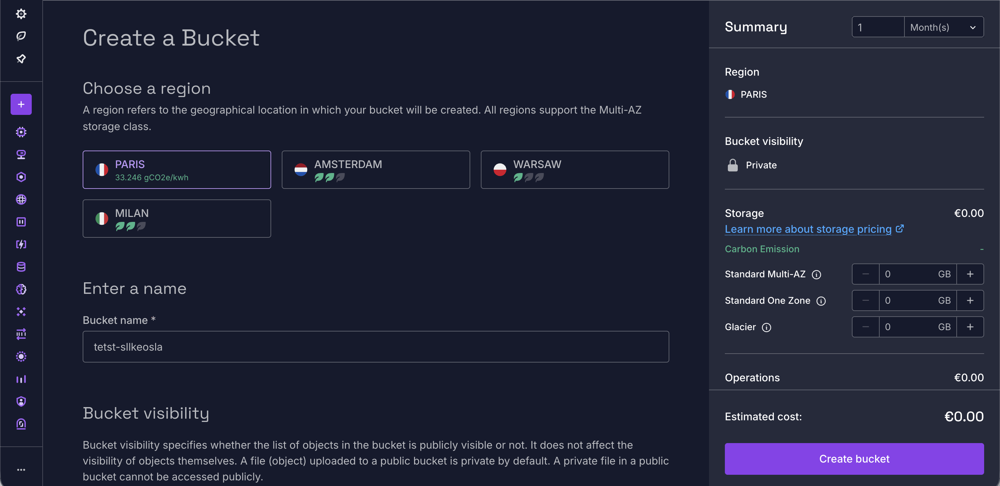
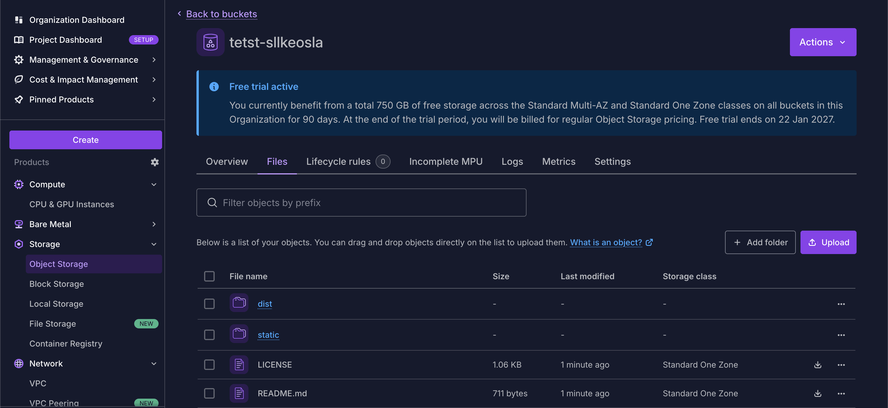
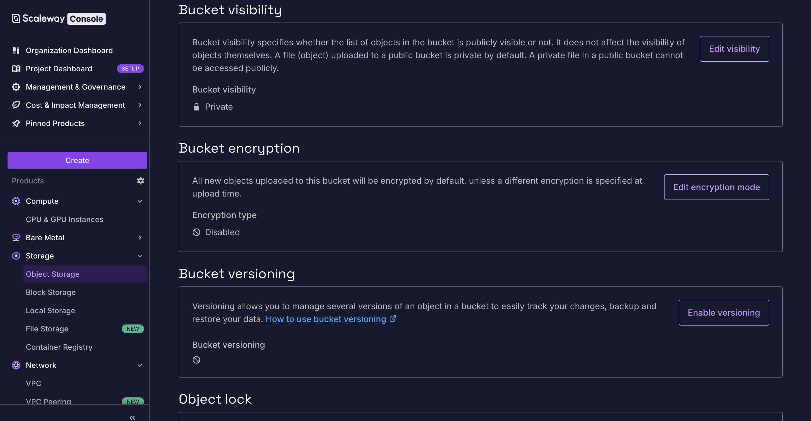
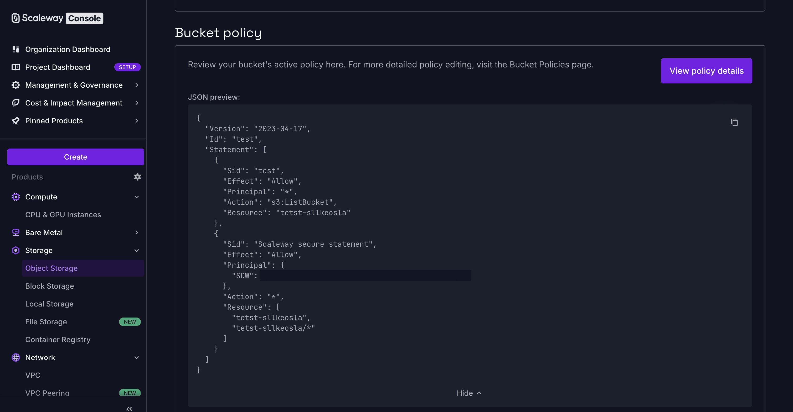
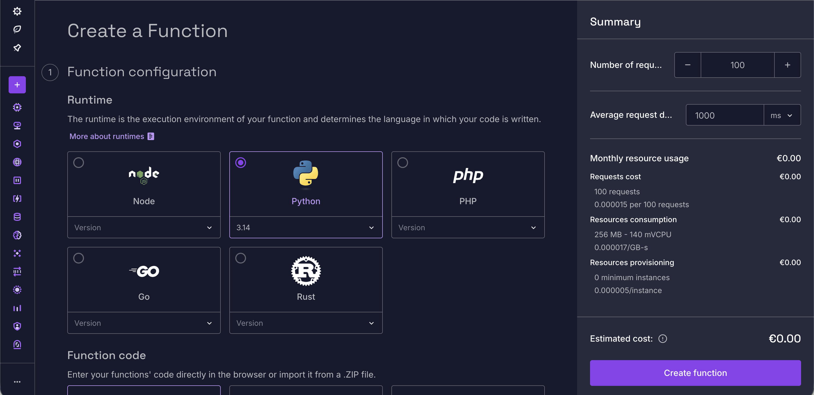
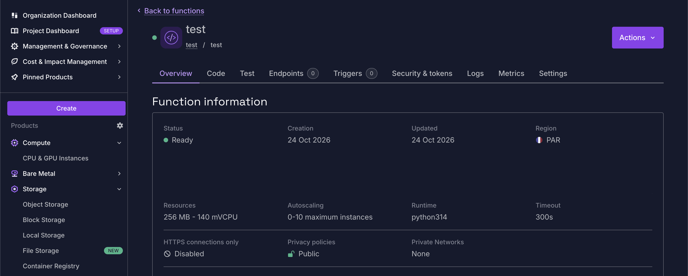
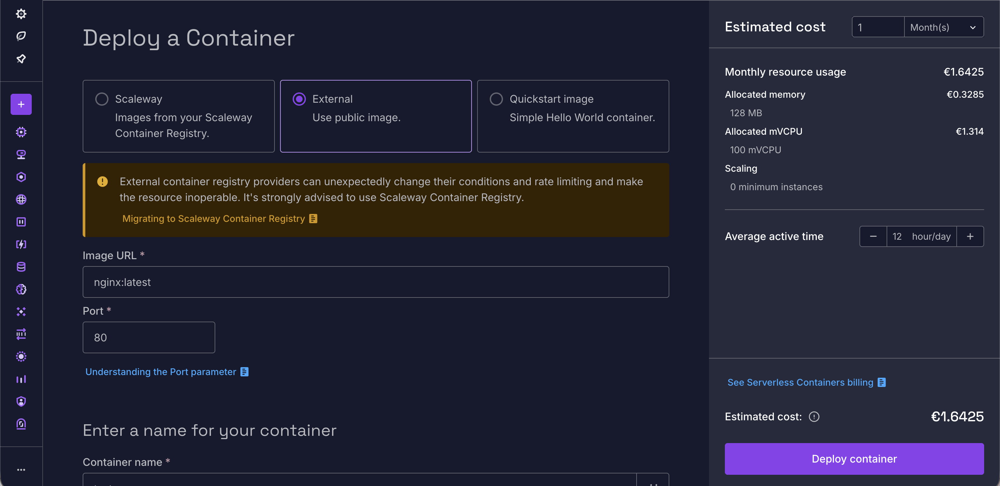
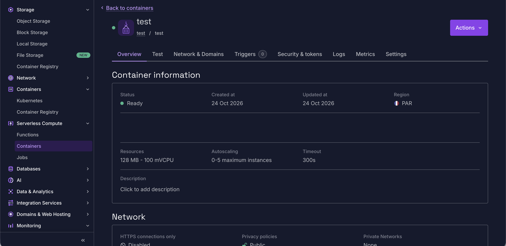

# Scaleway

- ヨーロッパ拠点のパブリッククラウド
- AIに強いらしい？

## Object Storage
- S3互換
  - 非常にS3に似ている
  - 静的ウェブホスティングもできる
    - indexのファイルは指定できるし何ならエラーページ(404)も設定できる
    - S3でエラーページ指定できたっけ？
  - バケットポリシーなる概念もある
    - JSONの構造がAWSにすごく似ている
  - もちろんS3互換なのでAWS CLI経由で使える
  https://www.scaleway.com/en/docs/object-storage/api-cli/object-operations/#putobject
  - ライフサイクル設定も似ている気がする
  - incomplete MPU (multipart uploads) というページがありマルチアップロード途中のオブジェクト(それか失敗したやつ)が見れる？っぽい
- IAMはAWSとは違いそう
  - 見た感じ IAM Role 相当がない？ サービスアカウント的なものはあるのでどちらかというとGCPよりなのかな。
- リージョンはヨーロッパにしかないらしい
  - https://www.scaleway.com/en/product-availability-by-region/
  - 日本から使う分には大差ないと思うが。
  - 比較的 Paris が一番充実してそう。
  - なのでパリかなあ。
- Billingはユーロで表示される
- 
- 
- 
- 

## Serverless Functions
- Lambda相当
- ランタイムとして Node.js や Python や Go, Rust や PHP がある
  - PHP があるのはびっくり
- 裏側は Docker Image っぽい
  - Container Registry にイメージが作成されていた。
- 
- 

## Serverless Containers
- ECS / Cloud Run 相当
- ALB が必須ではないという意味で Cloud Run に似ている
- 
- 

## Links
- https://scaleway.com/
